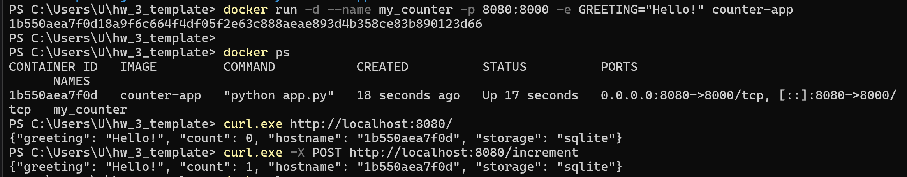
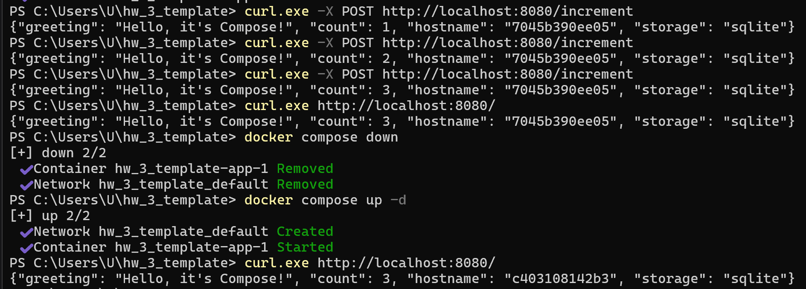

# Д/З по Docker


## 4 балла – один контейнер

Написала Dockerfile, собрала образ и запустила приложение. Опубликовала порт, передала приветствие через переменную окружения и проверила увеличение счётчика.


**Команды запуска:**

```bash
docker build -t counter-app .
docker run -d --name my\_counter -p 8080:8000 -e GREETING="Hello!" counter-app
```


**Логи:**

```
2026-11-24 17:35:25,512 listening port=8000 storage=sqlite
2026-11-24 17:35:56,714 http 172.17.0.1 "GET / HTTP/1.1" 200 -
2026-11-24 17:36:17,799 http 172.17.0.1 "POST /increment HTTP/1.1" 200 -
```





## 6 баллов – Compose и данные


Настроила запуск через Docker Compose. Сделала приветствие и порт, на котором приложение доступно в системе, настраиваемыми, добавила .env.example. Подключила именованный volume. Счётчик сохраняется после удаления и повторного создания контейнера.


**Логи:**

```

app-1  | 2026-11-24 18:02:34,212 listening port=8000 storage=sqlite

app-1  | 2026-11-24 18:02:45,261 http 172.18.0.1 "GET / HTTP/1.1" 200 -

```




